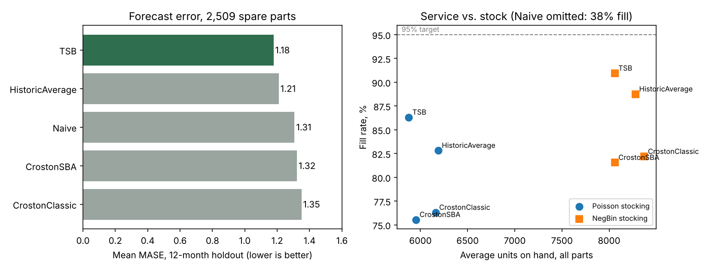

# Spare-Parts Demand Forecasting and Stocking

How well do standard intermittent-demand methods forecast spare parts, and does a better forecast translate into better service at the stocking shelf?

**Data:** Hyndman's `carparts` dataset: monthly demand for 2,674 car spare parts, January 1998 to March 2002 (R package `expsmooth`). Parts with missing months are dropped, leaving the 2,509 complete series used in the forecasting literature. This is a public stand-in for equipment spares, not semiconductor data.

## What the analysis does

1. **Classify demand** on the 39 training months with the Syntetos-Boylan-Croston scheme (average inter-demand interval ADI ≥ 1.32 = intermittent; squared coefficient of variation of demand sizes CV² ≥ 0.49 = variable).
2. **Backtest five methods** on a 12-month holdout with `statsforecast`: Naive, Historic Average, Croston, Croston-SBA, and TSB. Scored with MASE (mean absolute scaled error).
3. **Stocking test.** Each forecast drives an order-up-to policy (monthly review, 1-month lead time, 95% service target), replayed against actual holdout demand. Scored on fill rate (units served / units demanded) and average units on hand. Two ways to size the stock: Poisson around the forecast, and negative binomial using each part's own historical variance.

## Results



| | Count | Share |
|---|---|---|
| Intermittent | 2,187 | 87% |
| Lumpy | 287 | 11% |
| Smooth / Erratic / No demand | 35 | 1% |

| Method | Mean MASE | Fill rate (Poisson) | Fill rate (NegBin) |
|---|---|---|---|
| **TSB** | **1.18** | **86.3%** | **90.9%** |
| Historic Average | 1.21 | 82.8% | 88.7% |
| Naive | 1.31 | 37.9% | 38.1% |
| Croston-SBA | 1.32 | 75.5% | 81.5% |
| Croston | 1.35 | 76.3% | 82.2% |

**Findings**

- **TSB had the lowest error, 10% below Naive.** TSB updates the probability that a part is demanded at all, so its forecast decays when a part goes quiet. Croston and SBA only update after a demand occurs, so they keep forecasting parts that are fading out. On this holdout, both did worse than a plain historic average.
- **No method reached the 95% target.** Sizing stock as Poisson around the forecast assumes less variability than these parts actually have.
- **Variance-aware stocking closed about half the gap.** Using each part's own variance lifted TSB's fill rate from 86.3% to 90.9%, at the cost of 37% more units on hand (5,877 to 8,061). That is the service-versus-inventory trade-off a planner has to choose on purpose.
- **Naive looked best on median MASE (0.58) but would fail in practice.** Most parts have zero demand in most months, so "last month's value" is usually zero. That scores well on error and stocks nothing: 38% fill.

**Limitations.** Car parts, not semiconductor equipment parts. No lead-time variability, part cost, or criticality weighting; a real policy would set different targets for tool-down-critical parts. Lost-sales simulation with no expediting.

## Why this matters for installed-base spares

At an equipment maker, spares demand comes from an installed base of tools. Applied Materials' FY2025 10-K says AGS spares and service demand is driven by the installed base and customers' wafer starts and utilization, and that AGS is moving spares and service toward subscription agreements. The questions above map onto that business:

- **Which parts are fading.** TSB's decaying demand probability is a lifecycle signal: an early read on which parts are nearing end of life and might need a last-time buy when a part change notice lands.
- **What service level costs.** The fill-rate-versus-stock trade-off is the cost side of an uptime commitment in a service agreement.
- **Where to forecast from the installed base instead.** For parts with almost no history, a driver approach (tools installed × utilization × replacement rate per chamber-hour) is a better starting point than the part's own sparse history.

## Run it

```bash
pip install statsforecast scipy pandas matplotlib
python src/run_analysis.py   # writes results/*.csv
python src/make_charts.py    # writes results/results.png
```

`results/per_part_results.csv` has every part × method × policy row for a Tableau dashboard.

## Sources

- Hyndman, R.J. et al. *Forecasting with Exponential Smoothing* (2008); `expsmooth` R package, `carparts` data.
- Syntetos, Boylan & Croston (2005), "On the categorization of demand patterns," *JORS*.
- Teunter, Syntetos & Babai (2011), "Intermittent demand: Linking forecasting to inventory obsolescence," *EJOR* (TSB).
- Applied Materials FY2025 Form 10-K, AGS segment description.
